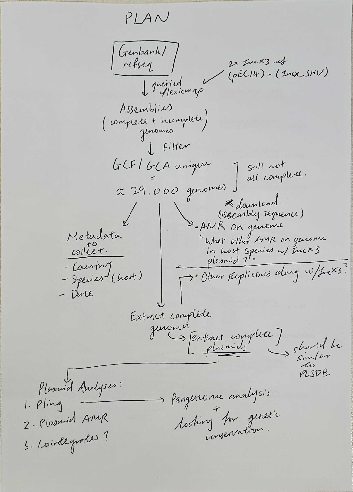

## **261006**
1. Continue working on the deduplication of plsdb with refseq
    - Working on the script so I can just plug and play
    - Doing it with plsdb at the moment
    - Got script to run - want to append the ichsm query of assembly completeness as well.
        - maybe append after deduplication is done
2. Have to then check for completeness - investigate ichsm as it seems to have that option to look at completeness 
    - ichsm has the option for completeness score if its there
    - Can look for completeness through assembly_level as well but have to use the assembly_accession as the input

## **261007**
1. Re-established plan
2. Using new plan 
    - Not deduplicating ATB anymore (not using it for now at least)
    - No need to get complete genomes to grep metadata
3. Taking the big txt file from genbank refseq (given by Leah) to grep for metadata from the GCF/GCA filtered list
    - Use grep to get all fields first then use csvtk to cut columns out
    - Taking `assembly_accession, bioproject, biosample, species_taxid, organism_name, version status, assembly_level, genome_rep, replicon_count`
4. Read the PLSDB paper to see how they went about extracting the complete plasmids from the assemblies on genbank refseq

## **261008**
1. Figure out what completeness mean and assembly level to determine which indicates a complete genome in terms of complete assembly.
    - Complete genome can mean WGS*
    - Testing with first 10 rows of refseq_final list
    - Can't get the completeness column when looking with random refseq samples but are there when there is a nucleotide sequence accession - ie. seqeunces from PLSDB
2. Run the grep on the whole of refseq genbank and take only the ones that say complete genome
    - Cannot find the metadata for the PLSDB ones that do not return a sample_accession from the ichsm search before
    - Want to keep columns from input file: `query,sgenome,assembly_accession,sseqid,qcovGnm,qcovHSP,pident,gaps,qstart,qend,sstart,send,slen`
    - Want to keep columns from results file: `assembly_accession,bioproject,biosample,species_taxid,organism_name,infraspecific_name,isolate,assembly_level,genome_rep,gbrs_paired_asm,genome_size,genome_size_ungapped,replicon_count,scaffold_count,contig_count,annotation_name,seq_rel_date`
    - Created the script but:
        - The matching needs to be the stripped numerals or else the GCF accessions will not match the sam array that has the GCA ones as the assembly_accession. 
        - Either that or go back to the sorting of the list and give GCA priority to be kept over the GCF - create new GCA list. 
    - topology??? to be investigated if information can be found
    - Ran the grep in batches (x30)
        - Printed results to own batch results to then concatonate all results together
        - When trying to put them together noticed that there were lesser lines than the input file
        - Checked the batch result files and noticed missing lines
        - When grep did not return anything it didn't print anything to results - added an exit fallback for grep so it prints NA for all columns instead
3. Using the code snippet from Michael to query collection date and geographical location
    - Tried first with assembly_accessions
        - Got results
    - Will try again with the proper biosample list from the grep 
        - Compare with results gotten from assembly_accessions

---
## **261009**
1. Finished gathering metadata using the big genbank file for refseq list
    - Noticed that some of them were not returning anything - replaced them with NA
    - Cut the ones without bioproject and biosample out to investigate
        - GCA_026288355.1 was replaced with a newer version GCA_026288355.2 (replaced in `refseq_metadata_results.tsv`)
2. Found that a lot of these missing ones is due to having grep take a specific version and it took the .1 version that was given from lexicmap search
    - Need to double check how the csvtk unique worked on the lexicmap results
        - ie. did it keep version .1 instead of the latest version .2 or so?
        - Need to csvtk sort numerals in reverse order or unique based on accession without version
3. Want to step back on how I did the unique things for the list as a sanity check. 

## **261013**
1. Finish list for metadata and sequences - genbank
    - Do the grep again but this time using the GCA without version number
    - Decided not to do that - too complicated; rather, want to use the GCF priority list as the csvtk sort was reversed and therefore, if there were multiple version numbers, since keeping through csvtk uniq with sgenome_num that is reversed, the latest version number is kept along with if there is a GCF accession.
    - Altered the `metadata_batches.sh` code to remove anchoring of column 1 and to grep whole words so that I can parse and grep with both GCA and GCF accessions.
        - Not good; it grepped other columns -> move to try changing to GCA as that would remove the grepping of other columns resulting in other accessions being included. 
    - Tried to replace GCF with GCA before grepping and it resulted in 66 results that came back NA.
        - Manually checked NCBI and found that this is a version issue:
            - By changing a version .1 of a GCF to GCA .1, this changed it completely.
            - big genbank file only has the latest versions so the GCA .1 version that has been superseeded cannot be found on it.
            - What is meant is that the GCF .1 version that was queried with lexicmap is the GCA .2 version which is the latest version but by just changing the GCF to GCA but not the version, it did not return a result.
    - So decided to make 2 separate lists of the GCF and GCA from the `GCF_priority_output.tsv` then grep / awk the results separately after batching.
        - Will combine all GCA and GCF into a file after individually filling in NA and cutting out columns of interest.
        - For GCA - cutting out just columns of interest in the default order = no change of assembly_accession column ($1) = also used as header for `genbank_results2.tsv`
        - For GCF - cutting out gbrs_paired_asm column to use as assembly_accession as it is the column for matching GCF accession that will match the input file of `GCF_priority_output.tsv`
    - Then match as per column 1 of results to column 2 of input file to combine both input file info = lexicmap query info and results file info = metadata from genbank txt file.
    - This is `genbank_output.tsv` which is renamed to `genbank_grep.tsv`
    - Still having issues - 41 to be exact
        - thought that I can fix it by just running the accessions without version numbers and it will return to be the latest one as there is the only latest one in genbank 

## **261014**
1. Re-ran the grep by using sgenome_no_version accessions 
    - This removed the version issue to returning only 5 problem accessions without bioproject/biosample
2. Manually checked the problematic accessions
    - Found that they were all suppressed due to the lexicmap search happening on an older index to the genbank txt file

    <table>
    <tr>
        <th style="text-align: left; width: 20px">Accessions</th>
        <th style="text-align: left; width: 270px">Problem</th>
        <th style="text-align: left; width: 220px">Fix</th>
    </tr>
    <tr>
        <td>GCA_054380255.1</td>
        <td><b>suppression</b> - replaced</td>
        <td>blast replaced seq to verify match to IncX3, then add results to list. Added GCA_056040515.1 in replacement</td>
    </tr>
    <tr>
        <td>GCA_054380215.1</td>
        <td><b>suppression</b> - replaced</td>
        <td>blast replaced seq to verify match to IncX3, then add results to list -> no assembly so: Remove  from list</td>
    </tr>
    <tr>
        <td>GCA_053953375.1</td>
        <td><b>suppression</b> - seq unable to be confirmed</td>
        <td>Remove  from list</td>
    </tr>
    <tr>
        <td>GCF_036905835.1</td>
        <td><b>suppression</b> - record removed for reasons unknown</td>
        <td>Remove  from list</td>
    </tr>
    <tr>
        <td>GCF_040720365.1</td>
        <td><b>Old version</b> - latest version was uploaded between lexicmap search and download of genbank txt file</td>
        <td>Update with new version manually into list if match with blastn: GCF_040720365.2. Added GCF_040720365.2 as replacement.</td>
    </tr>
    </table>

    <mark>

    - Need to check the replaced assemblies for match to IncX3 references
        - using blastn
3. Using the final list, search for the other metadata information - geo_loc and collection_date tmr.

## **261015**
1. Re run the metadata for geo_loc and collection date using the biosample list
    - Running it to fetch metadata into a tsv file for each batch and were batched by 1000
    - The output number was not matching the input list number
    - Was initially due to running with assembly_accession on the biosample database
    - After fixing that still missing some
        - was due to timeout so introduced random sleep to prevent NCBI limit
    - Then there was still a discrepancy and figured out it was due to the same biosample having multiple assemblies (2 different assembly_accessions)
        - This was not uniqued in the list and thus 29129 is an inflated number of biosamples but not assembly number
    - Need to go through the list to see which are the duplicate biosamples and figure out what are the differences between the 2 different assemblies and decide based on a standarised rule which one to include and which to exclude
        - ie. using read type used for assembly, assembly_level, contig number and completeness?

## **261022**
1. Deduplicate the list based on read type used for assembly, assembly_level, contig number and completeness
2. Start on prisma figure to track filtering of dataset
3. Finish getting all geo loc and collection date using this final list
    - Checked and one had a missing line batch_ad
    - Found that I did not actually finish replacing assembly accession `GCA_054380255.1` on the list so that resulted in one unable to be fetched in batch_ad
    - Manually added the results back to `genbank_output_final.tsv` but not to `genbank_output.tsv` which is the raw output from the grep
        - Also ammended `genbank_output_final2.tsv` which is `genbank_grep.tsv`
        - Also ammended `genbank_grep_dedup.tsv` after checking that there isnt another assembly that has the same biosample `SAMN53327818`.
    - Separated the information to be more curated:
        - geo_loc split to have country and city
        - collection date split to have additional column of just the date
    - File = `date_geo_metadata_curated.tsv` 
    
*Want to combine metadata into a single file tmr*
